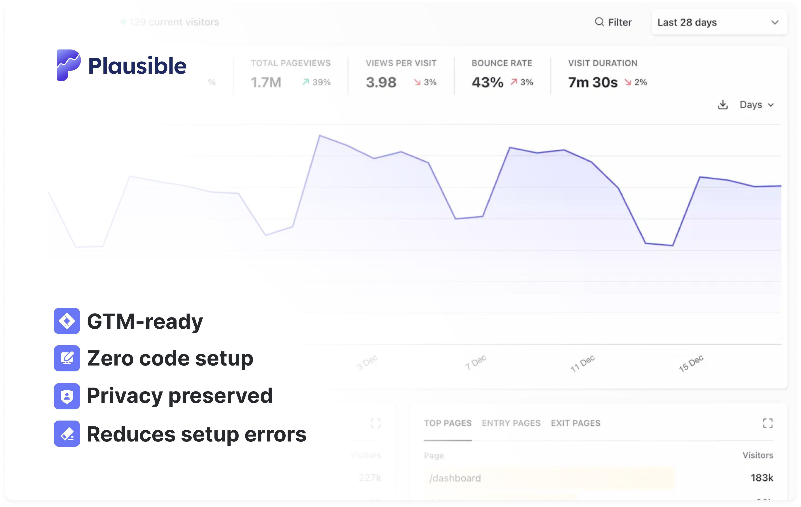

If you already use Google Tag Manager, adding Plausible takes a few minutes and no code changes. Our official GTM template is available in the template gallery and handles everything: pageview tracking, custom events, file downloads and more.

Unlike heavier analytics tools, Plausible collects no personal data, requires no cookie banner and won’t slow your site down. Once it’s running, you get accurate, privacy-friendly analytics in one clean dashboard.



This GTM integration method is optional. You can always use the [direct Plausible setup](https://plausible.io/docs/plausible-script) instead. It only takes a few lines of code. If you’re using another platform, you can also check out our [integration guides](https://plausible.io/docs/integration-guides) for instructions specific to your setup. 

1. Ordered list
{:toc}

## Why use the GTM template?

You manage your tracking where you already manage everything else. No developer needed, no code changes on your site and every change goes through GTM's preview and publish flow.

It's also handy for agencies. If you run many client sites from one GTM account, you can roll Plausible out to all of them the same way. Here's [how to manage analytics across multiple client sites with Google Tag Manager](https://plausible.io/blog/gtm-multi-site-analytics-management).

## What you can track

All of it is set up with checkboxes and GTM triggers:

* Pageviews on every page, including sites with hash-based routing
* [File downloads](https://plausible.io/docs/file-downloads-tracking), [form submissions](https://plausible.io/docs/form-submissions-tracking) and [outbound link clicks](https://plausible.io/docs/outbound-link-click-tracking)
* [404 error pages](https://plausible.io/docs/error-pages-tracking-404)
* [Custom events](https://plausible.io/docs/custom-event-goals) from any GTM trigger, such as button and link clicks
* Events your site already sends to Google Analytics 4 through the data layer, such as `sign_up`, `add_to_cart` or `purchase`
* [Revenue](https://plausible.io/docs/ecommerce-revenue-tracking) from purchases and other events
* [Custom properties](https://plausible.io/docs/custom-props/introduction) from any GTM variable

## Getting started

Setup takes a few minutes. Copy your script ID from the Tag Manager tab when you add your site to Plausible, add the template from the gallery and create one Initialization tag that fires on all pages. Then publish your container.

See the full setup guide in our [Google Tag Manager documentation](https://plausible.io/docs/google-tag-manager-integration).

## What’s next?

Now that your site is tracking with Plausible via GTM, you can:

* [Get the most out of your Plausible experience](https://plausible.io/docs/your-plausible-experience)
* [Connect your Google Search Console to Plausible](https://plausible.io/docs/google-search-console-integration) to see the search terms driving your traffic directly in your dashboard
* Build custom dashboards and client reports by connecting with the [official Data Studio connector](https://plausible.io/looker-studio-connector). Blend your Plausible data with ad spend, CRM data or any other source in one report.

If you haven't tried Plausible yet, sign up for a free 30-day trial, no credit card required. Thousands of teams including Basecamp, Sentry and the Python Software Foundation trust Plausible with their analytics.
