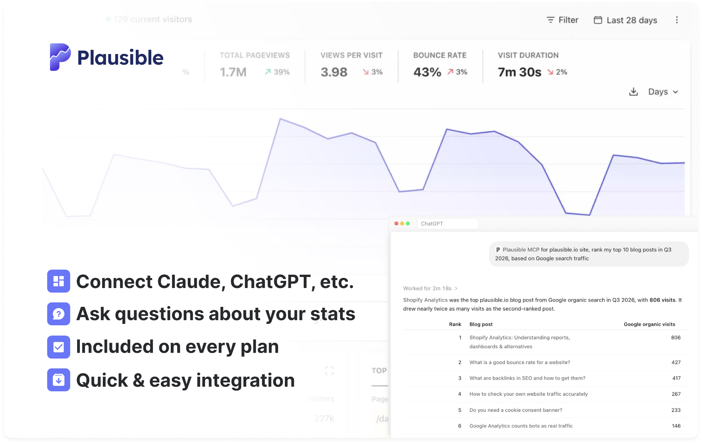

Plausible is built so you can check your stats in a minute and get on with your day. Some questions take more than one look though. What changed since last week? Which posts are losing search traffic? What goes in the monthly report?

With the official Plausible MCP server you ask those questions in plain language. Connect ChatGPT, Claude, Grok, Cursor or another compatible assistant and it gets the answers from your Plausible stats. There is no API key to create and no queries to write.

Your assistant gets read-only access to the same aggregated stats you see in your dashboard. Plausible doesn't collect personal data, so there are no visitor profiles to hand over. It's included on all plans at no extra charge.

**[Connect your assistant →](/docs/mcp)**



1. Ordered list
{:toc}

## Chat with your website stats

Start with whatever you’re curious about and ask follow-up questions as you go.

### Find what drove a traffic change

Say traffic jumped after a launch. To see where those extra visits came from, you could start with a question like this.

> Compare last week’s traffic with the week before. Which sources and landing pages contributed most to the change?

### Decide which pages to improve

When you’re deciding which pages to update, start with ones that already get traffic from Google. If your assistant has access to both Search Console and Plausible, you can narrow down the list with a question like this.

> Compare my top landing pages from Google Search last month. Which ones got plenty of clicks in Search Console but had a low signup rate among Google visitors in Plausible?

### Draft a monthly update

When it’s time to share what changed, give your assistant the same brief you’d give a teammate.

> Draft a short update for my team. Compare last month’s traffic and signups with the month before, and highlight which sources changed most.

If you track signups as a [goal](/docs/goal-conversions), your assistant can include them alongside traffic and sources. Review the draft and add context, like a newsletter you sent or a campaign you paused.

## Connect in three steps

Once you connect Plausible, you can ask about your website’s traffic, top pages and conversions right from your usual chat. You don’t need an API key.

1. In your AI assistant, add `https://plausible.io/mcp` as a connection.
2. Sign in to Plausible and choose the team you want your assistant to access.
3. Ask your first question, like “Which pages brought in the most visitors last week?”

Find instructions for your assistant in the [setup guide](/docs/mcp).

## What your assistant can access

Your assistant can access your Plausible dashboard's aggregated stats. You can disconnect it anytime under **Connected apps** in your Plausible account.

When you ask a question, Plausible shares the stats your assistant requests with its provider. The provider handles those stats under its own terms and privacy settings. [Read about privacy and access](/docs/mcp#privacy-and-access).

## See how much traffic AI assistants send you

Plausible’s [AI traffic analytics](/track-ai-traffic) shows how many visitors reach your site from tools like ChatGPT, Claude, Grok, etc. With Plausible connected, you can ask your assistant, “How many visitors came from AI assistants last month?”

## Frequently asked questions

  
What do I need to get started?

  
A Plausible account that is a member of the team whose sites you want to query, and a compatible AI assistant such as ChatGPT, Claude, Grok or Cursor. The MCP server is included on all plans and works during the free trial. Your assistant may have its own subscription requirements.

  
What is MCP?

  
Model Context Protocol (MCP) is a way for AI tools to connect to other services. Plausible's MCP server lets your assistant request stats to answer your questions.

  
Can my assistant see everything in my dashboard?

  
It follows your plan. Custom properties and revenue metrics are available on plans that include them. Funnels are not available through the MCP server.

  
Is there a limit on how much I can ask?

  
Starter and Growth include 300 requests per hour and Business includes 600. The allowance is per team and one question can use several requests. <a href="/docs/mcp#request-limits">See request limits</a>.

