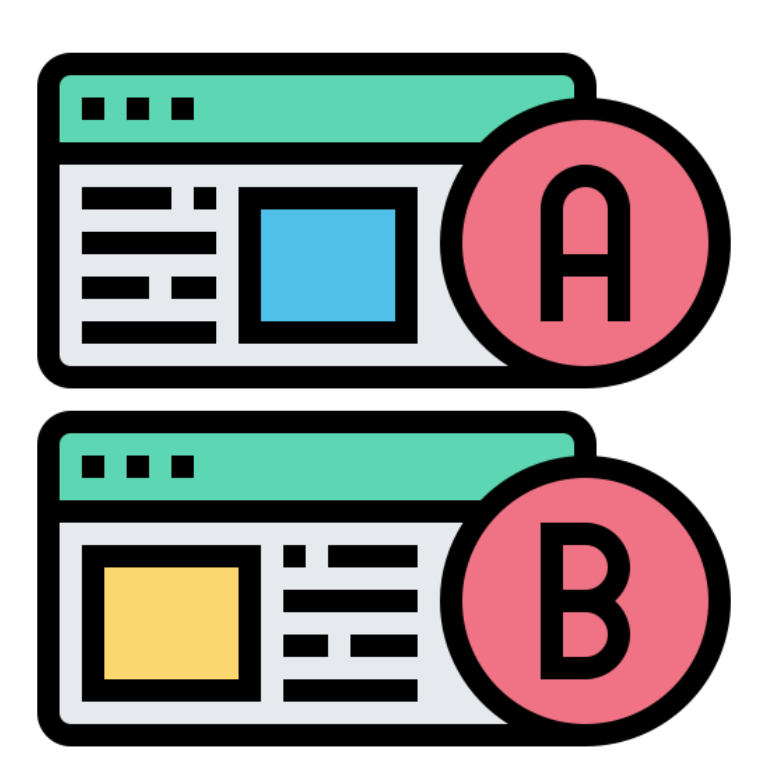
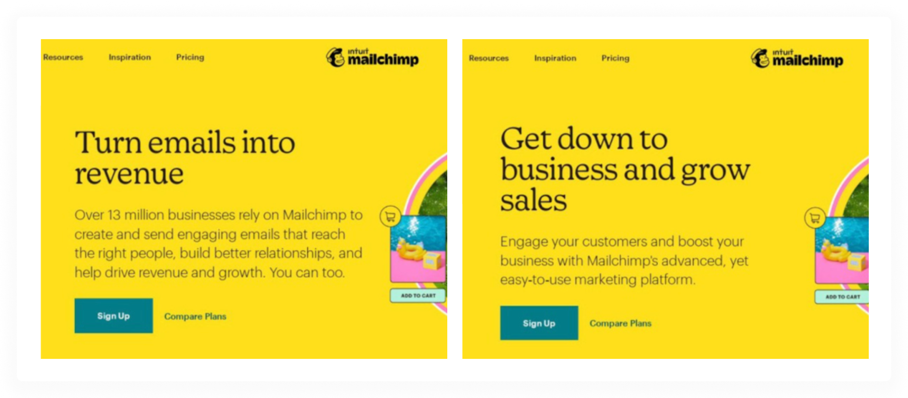

User behaviour keeps evolving. This means many things that used to resonate five or ten years ago, won’t now. For instance, a few years ago, it was normal to visit homepages of news outlets and now most of us prefer algorithm-curated, bite-sized news over full articles.

Earlier, it was normal to browse info-heavy, desktop-first websites where clicking through menus and pages was expected. Now? Users primarily use mobile, expecting fast, thumb-friendly designs, and preferring clean layouts with a clear, singular purpose per page.

Such evolving behaviours also apply to smaller things like a subconscious preference for certain colours, website layouts, messagings, etc. This usually leave a lot of room to experiment for brands in terms of what could psychologically and behaviourally resonate with the customers of today.

* “Which messaging would resonate best with my audiences? A short one telling about my product’s benefits or a longer one talking about its outcomes?”
* “Does including customer logos on the homepage increase sign ups? Or a minimal, non-pushy design without the logos assumes more trust?”
* “Does a strikethrough pricing with a promotional 20% off convert better than a simply written amount?”
* “Does a sign-up button placed on the top-right make more sense for my audience, or one placed in the center of the landing page encourages sign up?”
* “Is a 4-column pricing layout clearer than a 4-boxed pricing layout?”

…and so on. These are questions that a website designer, marketer, content-writer, business owner––whoever working on the website––can wonder about. One way to find a definitive answer to such questions is to run scientific experiments and settle the debate with what the actual end users like.

Think of A/B testing as a way to engineer the closest version possible to that ideal webpage / website that hits the bulls eye – aligning with customer behaviours and best user experience.

1. Ordered list
{:toc}

## What is A/B testing?

The whole idea of an A/B test is to run a controlled experiment on a random set of audience by showing them two (or more) versions of the same element of a website (a homepage’s heading, placement of a CTA button, colour of the website, etc.) and deciding what works best to encourage actions like sign ups, revenue, subscriptions, wishlisting, or whatever it is that matters to you as a website owner.

A/B testing is also called split testing or bucket testing. Literally, it means that you split the current version of the website asset to be tested into 2 versions, symbolized by “A” and “B.” Everything else is kept the same, while either of those 2 versions are shown randomly to the people visiting the website.

You run this experiment for some time (like a week or a quarter) depending on the nature and scale of the experiment, and see which of the versions win. This is a scientific and data-backed way of picking clearly what works and not relying on guesswork or intuition.

Say, you sell cotton socks through an e-commerce site and it being summer, you’re running a promotional campaign. You design a web page for the same and want to see which promotional copy is more successful in driving sales through that web page:

**Variant A**: “Beat the heat! Get breathable cotton socks at 20% off.”

**Variant B**: “Summer Sale! Stay cool with 20% off on all cotton socks.”

You split the traffic evenly—50% of visitors see Variant A, and 50% see Variant B. At the end of the experimentation period, you track which group led to more purchases. If Variant B results in more people buying socks, you can conclude that its messaging is more effective.

Another common A/B test, especially back in the day, for landing pages used to be testing the right-left layout, i.e., whether it’s better to show the image on the right of the main messaging or to the left of it. Something like this:

There’s also multivariate testing, which is like A/B testing but a bit more complex. Instead of testing just one change at a time, you test multiple elements on a page—like the headline, image, and button text—all at once, in different combinations.

The goal is to see which combination of changes works best together. It’s a good option when you’re looking to fine-tune several parts of a page, but you’ll need a bigger sample size to get meaningful results.

## Real-world examples of A/B tests

### A/B testing from the 20th century

Why not begin with the example that pioneered the concept of A/B testing in marketing? In 1923, advertising trailblazer Claude Hopkins placed different promotional coupons in print advertisements to measure which ones attracted more customer responses. 

By comparing these outcomes, he could determine which ad copy was more persuasive. This is considered the first-ever A/B test conducted in the world of marketing.

### The “obvious” blue links

Google’s “50 shades of blue” experiment is one of the most famous A/B tests. At one point, Google couldn’t decide which shade of blue to use for link text in search results. To settle it, they ran an A/B test (more like an A/Z test) trying around 40 to 50 variations of blue on millions of users.

By measuring click-through rates on each variation, Google identified the most effective shade. This helped them earn an extra $200M in revenue each year, as [reported](https://www.theguardian.com/technology/2014/feb/05/why-google-engineers-designers) in The Guardian. 

### Bing surprised itself

At Bing, a minor headline change was initially dismissed as low priority and ignored for months—until an engineer ran a quick A/B test and found it boosted revenue by 12%, ultimately generating $100 million. ([source](https://hbr.org/2017/09/the-surprising-power-of-online-experiments))

### Creating a traveller’s urgency through scarcity

Booking.com openly [talks](https://partner.booking.com/en-us/click-magazine/industry-perspectives/role-experimentation-bookingcom) about the A/B experiments they run across their travel booking website to ascertain what’s best for the users and eventually encourages most bookings. 

One of the most talked about is their experimentation with showing “Sold out” for hotel listings, which created urgency in their users’ minds and led to more hotel bookings through their website.

They even have a director of experimentation, quoting whom:

> We run in excess of 1,000 concurrent experiments at any given moment across different products and target groups, allowing us to rapidly validate ideas and implementations. Each test is tailored towards a particular audience because we’re targeting specific solutions. This enables us to gather learnings on customer behaviours and discover what makes a meaningful difference for our users.

### Mailchimp’s perfect headline

Mailchimp tested its main headline: can you guess which one won?

🥁🥁The left one. 

## How to run an A/B test on your website?

A’ight, time to have some fun! If you’re curious or confused about what could work better on your website, here’s the steps to take to run an A/B (or A/B/C/D/…) test:

**1. Set a clear goal**\
Firstly, decide what it is that you're trying to improve. Sign-ups, purchases, clicks, or something else? The key is to test something which is measurable. This will guide your test and how you judge success.

**2. Choose one variable to test**\
Start small. Focus on changing one thing at a time—like the wording of a button or the placement of a form. This keeps your results clean and helps you understand what’s actually driving change.

**3. Create your variants**\
Make two versions of the page or form or button or whatever you’re testing: version A (the original) and version B (the one with the change). Keep everything else the same so you're isolating the impact of your change.

You can run A/B tests on your website programmatically using custom code or server-side logic, or by using your CMS if it supports A/B testing features. Alternatively, you can use third-party A/B testing tools, client-side JavaScript via tag managers, or feature flag platforms that offer experimentation capabilities.

**4. Split your audience randomly**\
Divide your traffic randomly and evenly between the two versions. This helps make sure your comparison is fair, not skewed by user type, location, or device.

If there are more versions, divide equally still. For a A/B/C/D test, you could divide your traffic in such a way that each version is shown to 25% of the traffic. Although, this is not a rule…if you want, you can assign weights and unequally split the traffic between your variants. 

Again, this can be achieved programmatically or with the A/B testing tool of your choice.

**5. Let the test run long enough**\
Be patient—don’t stop the test too early. You need enough data from both versions to get trustworthy results. A general rule: run it for at least one full business cycle, to account for day-to-day variation.

Also, resist the urge to constantly check results. Looking too soon (and making decisions based on early results) can lead to false positives. Stick to your planned test duration.

## How to track and analyze the A/B test and its results?

You can track the performance of each version of your A/B tested marketing asset by comparing how many visitors saw each variant with how many of them converted. That gives you the conversion rate of each variant.

Plus you can [segment](https://plausible.io/audience-segmentation) it further by locations, devices, traffic acquisition sources, entry pages, and exit pages. 

Here’s an example: Let’s say you wanted to increase your newsletter subscriptions and A/B tested the call-to-action copy for 30 days, with two variants: “Subscribe Now” and “Get free tips.” Filter your [Plausible](https://plausible.io/simple-web-analytics) dashboard by your newsletter goal and open the custom property that holds the variant in the **Properties** tab. You see how many visitors signed up with each variant, such as 108K with “Subscribe Now” and 57.3K with “Get free tips.”

That doesn't make “Subscribe Now” the winner yet. If it was shown to twice as many visitors, both variants convert at about the same rate. Remove the goal filter to see how many visitors saw each variant. Then enter the numbers into our [A/B test significance calculator](/ab-test-significance-calculator). It shows the conversion rate of each variant and whether the difference is real. Don't use the **CR** column in the report for this. It's calculated against all the visitors to your site rather than against each variant's visitors.

If you want to see how the rest of the dashboard looks, feel free to explore our [live demo](https://plausible.io/plausible.io).

### How to set up A/B test tracking in Plausible?

You can make use of [custom properties](https://plausible.io/docs/custom-props/introduction) (available on the Business plan) to see analytics for different tested versions of your website elements. You can attach custom properties in two ways:

**With a pageview**

Assume you are A/B testing the placement of your feature grid (a grid layout for a collection of the features you’re marketing on the page) for improving free trial sign up rates. Should it be on top or should it be further down the page?

One important note here is that pageviews are collected automatically with Plausible, so if you’re using two different URLs for such an A/B test, like yoursite.com/a and yoursite.com/b –– then there’s no setup to do as you can simply filter your dashboard by a page and see the associated stats for it.

However, it’s not a great SEO and UX practice to create two URLs like that. So, you’ll be managing this programmatically (or with the A/B testing tool of your choice).

Instead, set up a [pageview goal](https://plausible.io/docs/pageview-goals) and send custom props for the version of the page served along with it.

**With a custom goal**

Custom properties can be sent with a [custom goal](https://plausible.io/docs/custom-event-goals) as well. So if you’re improving form submissions by testing the colour of a form, and prefer to use custom goals instead of pageview goals, then this option is available too.

The cool part is that you can directly filter your dashboard with the custom properties too, i.e., without filtering by the associated goal, so that you can see how your general traffic does wrt to the variants.

See [how to measure A/B tests with Plausible](https://plausible.io/docs/ab-testing) in our docs for the full setup.

## Watch out for

### SEO disruptions

It’s good to be protective about your rankings while conducting such tests, especially thorough and large-scale tests. Google has issued [guidelines](https://developers.google.com/search/blog/2012/08/website-testing-google-search) on conducting experiments and A/B tests, here’s a concise version:

1. Avoid cloaking: Always show the same content to both users and Googlebot. Don’t serve different versions based on user-agent.
2. Use rel="canonical": When A/B testing with multiple URLs, use the rel="canonical" tag on variants to point to the original URL. This helps group them correctly without risking index exclusion like the noindex tag might.
3. Use 302, not 301 redirects: For test redirects, use 302 (temporary) to signal that the original URL should stay indexed. JavaScript-based redirects are acceptable too.
4. Keep tests short: Run tests only as long as needed to gather reliable data. Remove all test-related elements afterward to avoid penalties for perceived manipulation.

### Statistical significance

Statistical significance tells you whether the observed difference is likely real or just due to chance. Ensure your sample size is large enough. Too small, and even big differences may not be reliable. Use our [A/B test significance calculator](/ab-test-significance-calculator) to check your result and see how many visitors your test needs.

### Respect privacy and compliance

If your A/B test involves collecting user data (e.g., behavior tracking or form inputs), ensure it complies with GDPR, CCPA, or other relevant privacy laws.

### Consider page speed

Be mindful that A/B testing scripts or tools (especially third-party ones) can increase load times. Opt for asynchronous scripts and monitor performance throughout the test.

### Avoid testing during peak periods

Running tests during seasonal or promotional spikes (like Black Friday) may distort results and put revenue at risk. Use stable periods to get more reliable data.

### Segment your audience thoughtfully

Make sure your test and control groups are comparable. Use random sampling or other fair segmentation techniques to avoid skewed results.

## Lastly…

It’s always a good idea to A/B test when in doubt, no idea or intuition is small enough to not test out in the real world. Who knows? It might just be the missing link you were looking for.